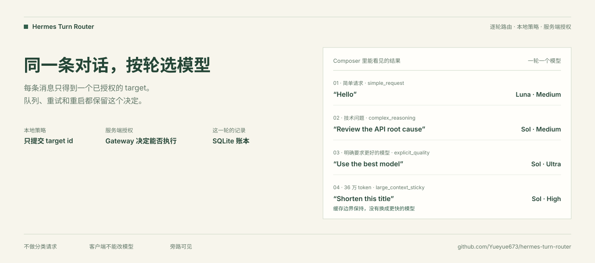
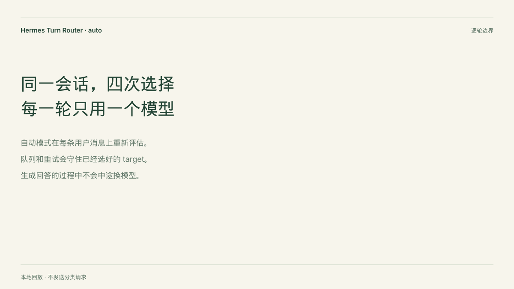
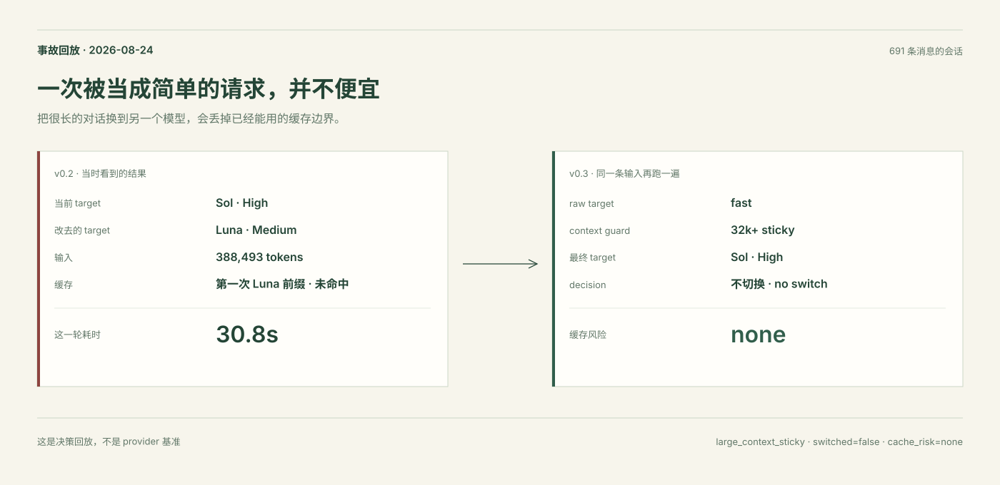
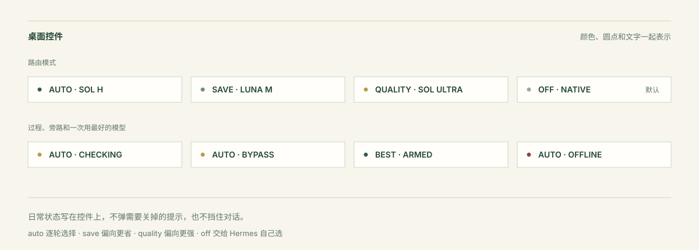
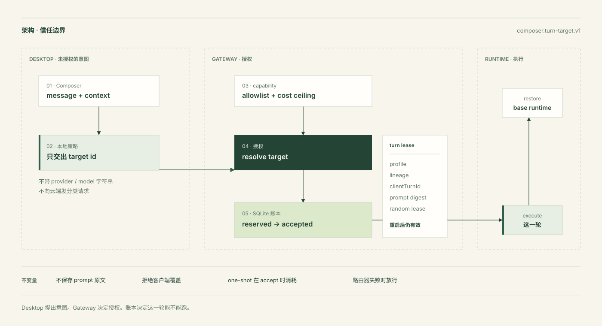

# Hermes Turn Router

[](https://github.com/Yueyue673/hermes-turn-router/releases/latest)
[](https://github.com/Yueyue673/hermes-turn-router/actions/workflows/ci.yml)
[](LICENSE)
[](package.json)
[](docs/compatibility.md)

Hermes Turn Router 是给 [Hermes Agent](https://github.com/NousResearch/hermes-agent) 用的本地路由：在 Desktop 发出每一轮对话之前，从允许的目标里选一个，并把这次选择在排队、重试、重启时保持下去。真正用哪家服务、哪个模型、推理强度和成本档，由 Gateway 决定，不是客户端说了算。

它不会再发一次分类请求，也不会改掉全局模型。Router 的记录里不保存消息正文。

[English](README.md) · [开始使用](docs/getting-started.md) · [架构](docs/architecture.md) · [兼容性](docs/compatibility.md) · [故障排查](docs/troubleshooting.md) · [最新版本](https://github.com/Yueyue673/hermes-turn-router/releases/latest)

> [!IMPORTANT]
> 策略核心和命令行工具可以跨平台使用。接到 Hermes 上的执行桥有意锁定上游版本，目前验证的是 Hermes Agent `0.20.5`、commit `2584b7c4eca82ada05f16eba08936d157b483329`。安装前请先看[兼容矩阵](docs/compatibility.md)。

## 看一次实际选择



这段动画直接调用真实的 `routeMessage()` 生成：简单请求、技术分析、明确要更高质量、36 万上下文时尽量保持缓存，以及经过测试的「能力对不上就旁路」路径。路由结果没有再经过模型生成，也没有人工改过。

固定用一个强模型，普通一轮对话也会把额度用掉。反过来，每条都随便换模型也可能更糟：长会话换到另一个模型后，已经建好的 prompt cache 可能用不上，延迟反而变长。

Router 会把这四类信息放进同一次判断：

- 当前这条消息里的信号，以及你明确选的模式；
- 服务端允许的目标，还有安全下限；
- 当前真实在用的模型，以及 **reasoning effort**；
- 上下文有多长、换模型的代价、对缓存的影响。

下面来自一次真实的 691 条消息会话。一个解释型回合从 Sol High 被切到 Luna，Luna 首次处理了约 388K 未缓存输入，用了 30.8 秒。v0.3 对同一输入的回放结果是 `large_context_sticky`：继续留在 Sol High，不切换，缓存风险为 none。



## 它会做的几件事

| 部分 | 行为 |
|---|---|
| 本地策略 | 同步的 TypeScript 纯函数，不访问网络和文件系统 |
| 四档目标 | 参考策略里有 Luna Medium、Sol Medium、Sol High、Sol Ultra |
| 缓存稳定 | Auto 在已经建立、上下文达到 32K 及以上的会话里，不会因为差一点就降档 |
| 明确控制 | Desktop 默认是 `off`；`auto`、`save`、`quality` 和 `Best once` 都要自己打开 |
| 服务端授权 | 客户端只提交不透明的 target ID，由 Gateway 解析真正的模型 |
| 持久准入 | SQLite lease ledger，包含 reserved / accepted / completed，以及冲突检测 |
| 对不上就旁路 | 能力或 policy / catalog 不匹配时会提示并旁路，不会把用户消息吞掉 |
| 真实状态 | Desktop 显示这一临时回合实际在用的模型和 effort |
| 回放评估 | target 分布、切换率、缓存风险、期望命中、usage 与 latency 字段 |
| 安装时的保护 | commit / hash 预检、ZIP 备份、Desktop staging、完整回滚 |

## 快速开始

### A. 先试策略核心

```bash
git clone https://github.com/Yueyue673/hermes-turn-router.git
cd hermes-turn-router
npm ci
npm run check
```

看一次真实决策：

```bash
node dist/cli.js route \
  --text "请仔细审查这个生产迁移方案" \
  --allow fast,balanced,strong,premium \
  --context-tokens 24000 \
  --current-provider openai-codex \
  --current-model gpt-5.6-luna \
  --current-reasoning medium
```

```json
{
  "target": {
    "id": "balanced",
    "label": "Sol · Medium",
    "provider": "openai-codex",
    "model": "gpt-5.6-sol",
    "reasoningEffort": "medium"
  },
  "score": 45,
  "reasons": ["high_impact"],
  "switched": true,
  "contextPenalty": 6,
  "cacheRisk": "medium"
}
```

回放仓库里附带的脱敏样本：

```bash
node dist/cli.js replay --input examples/replay.ndjson
```

小型 smoke fixture 包含 6 条期望决策。更完整的[参考评估](docs/reference-evaluation.md)覆盖 10 类、32 条中英文和带状态的事件：31 条受检决策全部命中，其中 1 条是预期的 `off` 旁路，路由错误为 0。

### B. 安装 Hermes 执行桥

先做预检：

```bash
python integrations/hermes/scripts/install.py check \
  --hermes-source C:/path/to/hermes-agent \
  --hermes-home C:/path/to/hermes-home
```

安装源码接缝、catalog、Desktop 插件、备份，并执行验证：

```bash
python integrations/hermes/scripts/install.py install \
  --hermes-source C:/path/to/hermes-agent \
  --hermes-home C:/path/to/hermes-home \
  --full-verify
```

安装到已验证的 Windows unpacked Desktop 发布版时，先彻底退出 Hermes，再追加 `--deploy-desktop`。新安装默认显示 `OFF · NATIVE`，保留 Hermes 原来的模型、推理档位和 Fast 输出控制；只有需要按回合路由时，才在输入框旁选择 `auto`。

前置条件、target catalog、打包部署、验收与回滚见[开始使用](docs/getting-started.md)。

## Desktop 模式



输入框旁的控件会同时用颜色、状态点、文字和 Tooltip。检查中、路由中、旁路、离线、原生关闭、已选目标和 one-shot 已就绪，都有明确文字，不单靠颜色说明状态。Router 的日常状态不会再弹出需要手动关掉、挡住对话的提示。

| 控件 | 含义 |
|---|---|
| `auto` | 每条重新评估，同时考虑安全、当前目标、上下文长度和缓存成本 |
| `save` | 明确偏向更省的一档，但保留安全下限 |
| `quality` | 明确偏向更强的模型 |
| `off` | 交给 Hermes 原来的模型选择器，也就是固定模型的用法 |
| `Best once` | 下一条被接受的回合，使用 Gateway 授权的、唯一最高的 `quality_rank`；rank 缺失或并列时会禁用，不会自行猜测 |

命令行和库仍然支持明确指定 `fixed` 目标。Desktop 不会再用第二套固定模型界面，去重复 Hermes 原来的选择器。

全新安装默认是 `off`。已经选过模式的用户，这个选择会留下来，插件更新不会强行改掉。

## 参考目标分档

内置 preset 只是参考，并不绑死某一家服务：

| ID | 参考目标 | 分数 | 比较典型的工作 |
|---|---|---:|---|
| `fast` | Luna · Medium | `<25` | 明确、低风险、可以核对的回合 |
| `balanced` | Sol · Medium | `25–59` | 分析、代码、多步执行 |
| `strong` | Sol · High | `60–89` | 影响更大的综合和审查 |
| `premium` | Sol · Ultra | `90+` | 明确要求高质量、做架构，或最后一轮对抗性审查 |

目标会在两个地方声明，各自承担不同责任：

- policy 目标：本地纯函数打分时用的元数据；
- Gateway catalog 目标：服务端对 provider / model / effort / cost 的最终授权。

两处 ID 必须一致。Gateway 不信任 Desktop 发来的 provider / model 字符串。

## 一条回合怎样走完



1. Desktop 在本地打分，只提交 `targetId` 和理由元数据。
2. Gateway 检查 profile catalog、成本上限、跨服务策略，以及是否需要批准。
3. SQLite lease 按 `(profile, lineage, clientTurnId)` 预留，并使用服务端计算的 prompt digest。
4. Gateway 应用已授权的目标；完全相同的目标直接不做改动，只改 effort 时不重建 Provider 客户端。
5. 一次性状态只在明确 accepted 之后才消耗。
6. 排队、重试和重启会保留同一份不可改的决策。
7. Gateway 写完 ledger，并在这一回合结束后恢复原来的运行环境。

完整协议见[架构](docs/architecture.md)和 [Hermes 集成](integrations/hermes/README.md)。

## 代码调用

```ts
import { codexLunaSolPolicy, routeMessage } from 'hermes-turn-router'

const decision = routeMessage({
  text: '认真检查这个迁移方案',
  mode: 'auto',
  policy: codexLunaSolPolicy,
  allowedTargetIds: ['fast', 'balanced', 'strong', 'premium'],
  estimatedContextTokens: 24_000,
  state: {
    currentProvider: 'openai-codex',
    currentModel: 'gpt-5.6-luna',
    currentReasoningEffort: 'medium'
  }
})
```

`routeMessage()` 是同步纯函数，没有副作用。策略会经过 JSON Schema 校验，可以配置云端服务、本地接口，或两者混合。

## 安全和隐私

- 策略在本地执行，不会把消息发给额外的分类模型。
- Gateway 拒绝客户端改写 provider / model。
- Catalog ID 有格式和数量边界。
- 高影响信号会执行可配置的最低档位。
- 批准用的 token 是短期 HMAC，绑定 profile、lineage、turn、target 和到期时间。
- Ledger 只保存哈希和生命周期元数据，不保存消息和附件正文。
- 能力协商有次数限制，对不上就旁路。
- 安装器会拒绝不支持的 commit、hash 不匹配、有未提交改动的工作区，以及不安全的 patch。

威胁边界和漏洞报告见 [SECURITY.md](SECURITY.md)。

## 兼容性

| 组件 | 当前状态 |
|---|---|
| Policy / CLI | Node 20+，Windows / macOS / Linux |
| Hermes source bridge | commit `2584b7c4eca82ada05f16eba08936d157b483329` |
| 已验证的 Hermes 版本 | `0.20.5` |
| Packaged Desktop 部署 | 已验证 Windows unpacked 发布版 |
| 其他服务商 | 已提供自定义 policy / catalog 的构建入口，必须按目标 profile 验证 |

完整矩阵见 [docs/compatibility.md](docs/compatibility.md)。

## 目前做不到的

- Hermes 执行桥目前还不是稳定的上游插件接口，现在用的是按版本提供的 patch，外加单独的 Desktop 插件。
- 参考 Router 用的是可以讲清楚的启发式打分，不是训练出来的语义分类器。
- 发布包默认嵌入已验证的 Codex 策略；其他服务商需要配套的本地策略、Gateway catalog，以及自定义插件构建。
- 还没有自动根据反馈学习和交互式批准界面。
- 默认的 Desktop 会隐藏需要 `requires_approval` 的目标，直到批准界面做完。
- macOS / Linux 的 packaged Desktop 部署还没有验证过。
- 服务传输卡住，仍然属于服务商或网络问题。Router 会减少不必换的模型，并显示实际在提供服务的模型，但不会在数据流已经打开后再发一次请求。

## 文档

| 文档 | 用途 |
|---|---|
| [开始使用](docs/getting-started.md) | 首次安装、验收、回滚 |
| [架构](docs/architecture.md) | 信任边界和回合生命周期 |
| [Hermes 集成](integrations/hermes/README.md) | patch manifest 与安装命令 |
| [命令行](docs/cli.md) | validate、route、replay 参数 |
| [参考评估](docs/reference-evaluation.md) | 自动生成的分类覆盖和目标分布 |
| [服务商](docs/providers.md) | 自定义 policy / catalog 验证与插件构建 |
| [兼容性](docs/compatibility.md) | 支持的平台与 Hermes 版本 |
| [故障排查](docs/troubleshooting.md) | Gateway、catalog、延迟、安装问题 |
| [Token 与缓存](docs/token-economics.md) | 缓存风险和评估指标 |
| [后续计划](docs/roadmap.md) | 当前范围和后面打算做的 |

## 开发

```bash
npm ci
npm run check
npm run render:assets
npm pack --dry-run
```

改路由策略时，需要带上行为测试，或一份脱敏的回放样本。改集成时，还要能证明干净安装、Gateway / Desktop 测试、适用情况下的打包部署，以及回滚。

参见 [CONTRIBUTING.md](CONTRIBUTING.md)、[行为准则](CODE_OF_CONDUCT.md) 和 [Issue 模板](.github/ISSUE_TEMPLATE/)。

## 项目状态

`0.5.4` 让全新 Desktop 安装默认进入 `OFF · NATIVE`，在主动打开路由之前，保留 Hermes 原来的 Fast 和模型控制。它继续保留 v0.5.3 的安静反馈、Sol Ultra，以及由 Gateway 明确给出的 `quality_rank` 权威。

这是社区项目，与 Nous Research 没有官方隶属关系。

## License

MIT，见 [LICENSE](LICENSE)。
